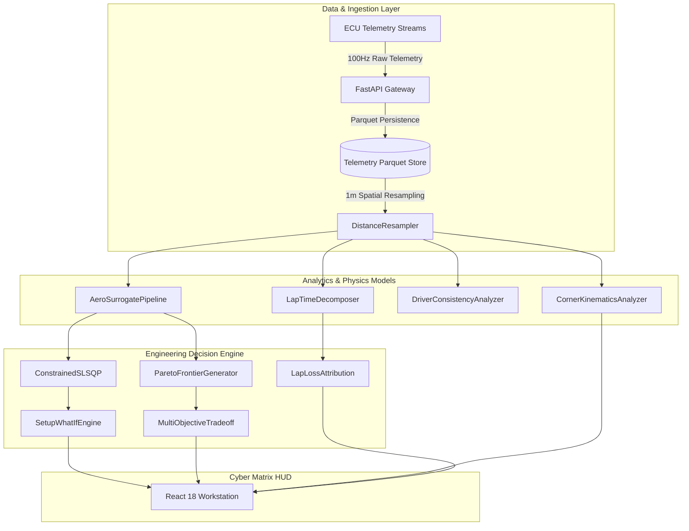

# ApexIQ Architecture & Pipeline Specification

## High-Level System Architecture

ApexIQ is designed as an end-to-end telemetry engineering and vehicle dynamics decision support platform.

## Core Engineering Invariants
1. **Spatial Invariance**: Telemetry comparisons are conducted over fixed $\Delta s = 1.0\text{ m}$ grids rather than varying temporal coordinates.
2. **Deterministic Residuals**: No unmeasured delta is discarded; $\Delta t_{\text{total}} = \sum \Delta t_{\text{phases}} + \Delta t_{\text{residual}}$.
3. **Surrogate Calibration**: GBDT aerodynamic surrogates enforce $v^2$ physical scaling and non-negative aerodynamic drag.
